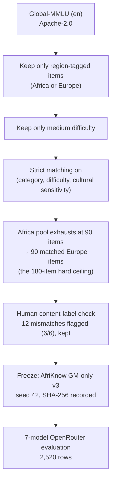
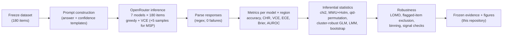

# Source-Controlled Benchmark Construction as a Validity Requirement for Regional Calibration Audits

*Do language models know when they are wrong about Africa? A source-controlled audit of seven LLMs says the earlier "regional overconfidence" signal may have been an artifact of comparing different benchmarks.*

[](LICENSE)
[](https://www.python.org/)
[](CHANGELOG.md)

---

## 1. Project overview

When AI evaluations report that large language models are less accurate — or more overconfident — on questions about Africa, what exactly is being measured? In most existing studies, the African questions come from one benchmark (typically AfriMMLU) and the European questions from another (typically Global-MMLU or Wikidata). The comparison therefore mixes two things that travel together: **the region** and **the benchmark source**, with all its source-specific difficulty, translation quality, distractor design, and content selection.

This repository contains a **source-controlled audit**: both regional arms come from the *same* benchmark. We take 180 Global-MMLU multiple-choice questions — 90 tagged Africa, 90 tagged Europe — matched on subject category, difficulty, and cultural-sensitivity label, all in English, all at medium difficulty, and evaluate seven commercial and open-weight models through the OpenRouter API (total cost: **$0.66**). Each model's *stated confidence* (a verbalized 0–100 estimate, "VCE") is the primary calibration signal; accuracy, Calibration Hit Rate, Expected Calibration Error, Brier score, and AUROC are reported per region, with clustering-aware statistics throughout.

**Findings:** under source control, the Africa-overconfidence signature does not appear. Accuracy is statistically indistinguishable (Africa 87.5% vs. Europe 85.6%, p = .364); wrong-answer confidence is *not* higher for Africa-tagged items (0.761 vs. 0.832 — the point estimate leans the other way; permutation p = .726); and confident errors are slightly *less* likely on Africa-tagged items (10.5% vs. 13.6%). Calibration varies strongly **by model**, not uniformly by region. These nulls are reported with their minimum detectable effect (d ≈ 0.43 at 80% power) — they are *failures to detect*, not proofs of equivalence.

**Contribution:** a demonstration that regional calibration audits should hold benchmark source constant — and a complete, hash-frozen dataset, codebase, and evidence trail for anyone who wants to check or extend that claim.

## 2. Why this research matters

Regional evaluation increasingly drives fairness claims and deployment decisions. If a "regional overconfidence gap" is actually driven by benchmark construction, then mitigation effort targets the wrong cause, model rankings on fairness dashboards mislead, and confidence-based systems calibrate their risk to an artifact.

**An illustrative example (hypothetical, not an experimental result).** Suppose you compare Model X on African questions from AfriMMLU against European questions from Global-MMLU, and find X is wrong about Africa 25% of the time but about Europe only 10% — and notably, when wrong about Africa, X *insists* it is right. Which of the following is the cause?

1. X knows less about Africa, or
2. AfriMMLU's questions are harder, its distractors trickier, its translations less standard — for *any* model.

You cannot tell from the comparison, because region and source changed together. Now suppose instead that both arms come from Global-MMLU — same source, same format, same difficulty band — and the "overconfident about Africa" effect disappears. The earlier alarm becomes much harder to attribute to region. That is the logic of **source control**, and the point of this study: the illustration above is a design parable; the experiment in this repository is the real, measured version of it.

Two distinctions matter throughout this work:

- **Calibration ≠ accuracy.** A model can be accurate everywhere and still be dangerously confident when wrong (or vice versa). Calibration audits ask a different question than accuracy audits, and need different metrics ([Guo et al., 2017](https://proceedings.mlr.press/v70/guo17a.html)).
- **Null results are informative — with power.** Our design detects effects of d ≈ 0.43 and larger with 80% power, and d ≈ 1.0 with near-certainty. The earlier mixed-source literature reported effects around that magnitude. Their absence here is therefore meaningful evidence *against an effect of that size under this design* — while leaving smaller effects open. We do not claim equivalence.

## 3. Research question and hypotheses

**Central research question:** *When benchmark source is held constant, does a regional calibration gap persist?*

| Hypothesis | Content | Chronology (disclosed in the [Analysis Plan](docs/methodology/EXPERIMENT_PROTOCOL.md)) |
|---|---|---|
| **H3** (primary) | Wrong-answer confidence is higher for Africa-tagged than Europe-tagged items (pre-specified, directional) | Specified **before** the GM-only evaluation ran; reported **two-sided** because data were collected before final plan freeze — disclosed |
| **H1** | Regional accuracy comparison | Added as a supporting signal during first data inspection |
| **H2** | Calibration Hit Rate comparison | Added as a supporting signal during first data inspection; **descriptive only** (no inferential test performed) |

The three hypotheses form a ladder: accuracy asks whether models *know* differently, wrong-answer confidence asks whether they *admit* uncertainty differently, and CHR asks what the confident-error risk looks like operationally. Mixed-effects models and all sensitivity checks are post-hoc and labeled as such; no analysis was selected on the basis of its result.

## 4. Background and related work

Three literatures meet in this project; the [full review](docs/literature/LITERATURE_REVIEW.md) and [verification status of every reference](docs/literature/REFERENCE_VERIFICATION.md) are documented.

- **LLM confidence and calibration.** Verbalized confidence can be elicited by simply asking ([Kadavath et al., 2022](https://arxiv.org/abs/2207.05221); [Tian et al., 2023](https://aclanthology.org/2023.emnlp-main.330/)); it is frequently overconfident ([Xiong et al., ICLR 2024](https://openreview.net/forum?id=gjeQKFxFpZ)); aggregate ECE can be gamed by flat confidence ([Si et al., 2022](https://aclanthology.org/2022.findings-emnlp.206/)), which is why we report ECE alongside Brier, AUROC, and CHR.
- **Geographic bias in LLMs.** Models show systematic geographic disparities ([Manvi et al., ICML 2024](https://proceedings.mlr.press/v235/manvi24a.html); [Mirza et al., 2024](https://arxiv.org/abs/2401.17839); [Moayeri et al., FAccT 2024](https://dl.acm.org/doi/10.1145/3630106.3658955)) — but these are *accuracy* findings; the calibration question was open.
- **African NLP benchmarks.** [IrokoBench/AfriMMLU](https://arxiv.org/abs/2406.03368), [AfroBench](docs/literature/LITERATURE_REVIEW.md), and [Global-MMLU](https://arxiv.org/abs/2412.03304) (the source benchmark here, which tags items by region and cultural sensitivity). Earlier Africa-vs-Europe comparisons drew the two arms from *different* members of this list — the confound this study removes.

## 5. Research gap and contribution

**What was missing:** no prior source-controlled regional calibration audit — i.e., no audit in which both regional arms come from the same benchmark with matched composition. Earlier work documented geographic accuracy gaps and LLM miscalibration separately, and demonstrated that benchmark construction choices move results ([Global-MMLU](https://arxiv.org/abs/2412.03304) shows model rankings change on culturally sensitive subsets), but did not test whether *regional calibration conclusions* survive source control.

**What this study contributes:**

1. **AfriKnow GM-only v3** — a frozen, hash-verified, 180-item source-controlled slice of Global-MMLU (90/90, matched composition, documented 12-item label-noise handling), released under the upstream Apache-2.0 license with full provenance.
2. **A complete source-controlled audit** of seven models with clustering-aware statistics and every robustness check reported.
3. **A methodological claim with an honest causal boundary:** source-controlled audits give a different (and more interpretable) picture than mixed-source comparisons; the source-confounding *explanation* is consistent with the data but not causally demonstrated — the matched within-study experiment remains future work ([roadmap](docs/RESEARCH_ROADMAP.md)).

We avoid "first ever" claims; the gap statement is bounded by the search in [`RESEARCH_GAP_ANALYSIS.md`](docs/RESEARCH_GAP_ANALYSIS.md) and is falsifiable.

## 6. Research design at a glance

| Component | Description |
|---|---|
| Source benchmark | [Global-MMLU](https://huggingface.co/datasets/CohereLabs/Global-MMLU) (English split; Apache-2.0) |
| Derived dataset | **AfriKnow GM-only v3** — 180 items, frozen, [dataset card](docs/dataset/DATASET_CARD.md) |
| Regional composition | 90 Africa-tagged / 90 Europe-tagged (matched: category + difficulty + cultural-sensitivity) |
| Difficulty / language | Medium only / English only (both documented limitations) |
| Models (7) | Claude-Sonnet-4.6, DeepSeek-V3.2, Gemini-2.5-Flash-Lite, Gemma-4-31B, GPT-4o-mini, GPT-4.1-Nano, Llama-3.3-70B |
| Inference provider | OpenRouter · 2,520 calls · $0.6556 · 4,448,016 tokens · zero failures |
| Primary confidence signal | **VCE** (verbalized 0–100 confidence ÷ 100) |
| Supporting signals | MSP (5 samples, T=0.8), fixed CoCoA composites (present in data; not validated methods) |
| Metrics | Accuracy, CHR(τ=0.70), wrong-answer VCE, ECE (10-bin + binning sensitivity), Brier, AUROC |
| Statistical methods | Pearson χ², Mann–Whitney U + Holm, qid-level permutation (10,000, seed 20260622), cluster-robust logistic regression, logit-normal LMM (qid random intercept), cluster bootstrap (100/2,000 resamples) |
| Known label noise | 12 US-history items with mismatched region tags (6/6), kept with leave-out robustness check |

## 7. Dataset construction

Every stage and its rationale is documented in [`docs/dataset/`](docs/dataset/DATASET_CONSTRUCTION.md). In brief:



Key points:

- **Both arms, one benchmark:** source, language, format, and difficulty band are constant across regions by construction.
- **Matching, not random sampling:** subject-category and cultural-sensitivity compositions are identical across arms (verified in the [quality report](docs/dataset/DATA_QUALITY_REPORT.md)).
- **A human content check found real label noise:** 12 US-history questions tagged Africa/Europe (6/6). We kept them in the primary analysis and show all conclusions survive their exclusion — an example of bounding metadata noise rather than hiding it.
- **Licensing:** Global-MMLU is Apache-2.0, so this repository publishes the full subset with attribution; a reconstruction path exists if upstream terms ever change ([details](docs/dataset/DATA_PROVENANCE.md)).

## 8. Methodology

Detailed documents: [methodology overview](docs/methodology/METHODOLOGY.md) · [metric definitions with equations and failure modes](docs/methodology/METRIC_DEFINITIONS.md) · [statistical analysis](docs/methodology/STATISTICAL_ANALYSIS.md) · [experiment protocol](docs/methodology/EXPERIMENT_PROTOCOL.md) · [decision rationale](docs/methodology/DECISION_RATIONALE.md).

**Confidence signals.** *VCE* — the model states a 0–100 confidence in its already-chosen answer; ÷100 gives a probability. *MSP* — five samples at temperature 0.8; the share agreeing with the greedy answer. VCE is primary; the CoCoA composites in the data are fixed α-mixtures of the two and are **not** treated as validated calibration methods.

**Metrics** (all per model and region, plus pooled):

- **Accuracy** — share of correct greedy answers.
- **CHR(τ=0.70)** — among predictions with confidence ≥ 0.70, the fraction that are wrong. Lower is better. Reported descriptively (no inferential test, stated wherever used).
- **Wrong-answer VCE** — mean confidence on incorrect predictions (H3).
- **ECE** — 10-bin equal-width expected calibration error, checked against 5-bin and 15-bin equal-mass variants (stable: 0.048 / 0.048 / 0.045). Known gameable by flat confidence, so never reported alone.
- **Brier score** — strictly proper; pooled 0.114.
- **AUROC** — confidence as a correctness discriminator; pooled 0.679 (moderate).

**Statistics.** The seven models answer the *same* questions, so observations are clustered by item. Row-level independence assumptions are avoided: qid-level permutation tests (region labels permuted at the question level, 10,000 permutations, seed 20260622), cluster-robust logistic regression (accuracy), and a logit-normal LMM with qid random intercept (confidence) carry the inferential weight. Power: **MDE ≈ d 0.433 at 80% power**; d = 0.30 → 49% power; d = 1.00 → ~100%. Nulls are reported as nulls, never as equivalence.

## 9. Experimental workflow



## 10. Results

Full details with verification commands: [`docs/results/RESULTS.md`](docs/results/RESULTS.md). Every number below was re-verified on 2026-10-30 directly from the raw CSV in this repository.

| Metric | Africa | Europe | Ratio A/E | Test | p |
|---|---|---|---|---|---|
| Accuracy (H1) | 87.5% (551/630) | 85.6% (539/630) | 1.02 | χ²=0.823 · qid-perm · cluster-robust GLM (β_Europe = −0.17) | .364 · .677 · .646 |
| Wrong-answer VCE (H3) | 0.761 (n=79) | 0.832 (n=91) | 0.92 | MWU · qid-perm · Cohen's d = −0.317 | .234 · .726 · — |
| CHR₀.₇₀ (H2, descriptive) | 10.5% (601) | 13.6% (609) | 0.77 | — (no inferential test) | — |
| Pooled ECE | 0.048 (95% CI [0.032, 0.083]) | | | cluster bootstrap, 2,000 resamples | |
| Pooled Brier / AUROC | 0.114 / 0.679 | | | | |

Mixed models: region coefficients are small and non-significant (accuracy β_Europe = −0.165, p = .646; confidence β_Europe = +0.152, p = .421) while model effects are large (Gemma +4.05, Llama +2.73 on logit-confidence, p < .001) and item-level variance is substantial (σ² = 1.30, p < .001). **Calibration is mostly a property of the model and the item — not the region.**

Figures: [accuracy by region](results/figures/accuracy_by_region_v18.png) · [ECE by model and region](results/figures/ece_comparison_v18.png) · [reliability curves](results/figures/reliability_curves_v18.png) · [CHR across thresholds](results/figures/chr_by_tau_v18.png) · [H3 effect sizes](results/figures/h3_effect_sizes_v18.png).

## 11. Interpretation

In one sentence: **the Africa-overconfidence signature reported by earlier mixed-source comparisons does not appear when the benchmark source is held constant.**

- **What the evidence supports:** no detectable regional accuracy or wrong-answer-confidence difference under source control, with useful power against moderate-to-large effects; strong model-level calibration differences; model-specific region asymmetries (in both directions).
- **What it does not establish:** equivalence (effects below d ≈ 0.43 remain possible); causality (the source-confounding explanation is a between-study argument); generalization beyond medium difficulty, English, history-heavy content, and this 7-model panel.
- **Why the nulls matter:** earlier mixed-source work reported large effects; a design with near-certain power at d = 1.0 failing to see them is meaningful evidence against effects of that size *under source control*.

Full reasoning, including the alternative-explanations table: [`RESULT_INTERPRETATION.md`](docs/results/RESULT_INTERPRETATION.md). Robustness suite (leave-one-model-out, flagged-item exclusion, binning, permutation validity with a negative control): [`ROBUSTNESS_CHECKS.md`](docs/results/ROBUSTNESS_CHECKS.md).

## 12. Limitations

The complete list with discussion is in [`KNOWN_LIMITATIONS.md`](docs/results/KNOWN_LIMITATIONS.md). The most consequential:

1. **Single benchmark source** — the null says nothing about African-built benchmarks like AfriMMLU.
2. **180-item ceiling** — MDE ≈ d 0.43 at 80% power; smaller effects unexcluded; nulls are not equivalence.
3. **Medium difficulty only; English only.**
4. **Binary regional aggregation** — "Africa" spans 54 countries; no subregional analysis is powered.
5. **History-heavy content** (~71% of items), inherited from Global-MMLU's tag distribution.
6. **Single prompt template; temperature asymmetry** (T=0 closed vs T=0.8 open-weight for greedy answers).
7. **No post-hoc calibration baselines** (temperature scaling, Platt, binning); **no AUPRC**.
8. **Seven-model, English-route panel** — not all families or systems.
9. **Known label noise:** 12/180 content-label mismatches, handled by a leave-out check.
10. **Between-study confounding comparison** — the causal question needs the matched experiment (future work).

## 13. Repository structure

```text
source-controlled-regional-calibration/
├── README.md                      ← this file
├── docs/                          ← all narrative documentation
│   ├── PROJECT_INVENTORY.md       ← every artifact, status, and provenance class
│   ├── literature/                ← review, related-work matrix, gap analysis, reference verification
│   ├── dataset/                   ← dataset card, provenance, construction, quality, regional composition, dictionary
│   ├── methodology/               ← methodology, protocol, statistics, metrics, decision rationale
│   ├── results/                   ← verified results, interpretation, robustness, limitations
│   └── publication/               ← verified 2027 venue analysis and submission roadmap
├── data/
│   ├── raw/                       ← frozen model outputs (2,520 rows; SHA-256 pinned)
│   ├── curated/                   ← AfriKnow GM-only v3 (180 items; SHA-256 pinned)
│   ├── metadata/                  ← run manifest + sample design manifest
│   └── manifests/                 ← experiment manifest (AFRIKNOW_V18)
├── src/afriknow_calib/            ← tested reference implementations (metrics, dataset, schema)
├── scripts/                       ← primary pipeline, verification, robustness, utilities
├── results/
│   ├── figures/                   ← the five canonical figures
│   └── reports/                   ← frozen evidence files (JSON/CSV) + rerun logs
├── reproducibility/               ← hashes, audit trail, prompts, run logs
├── tests/                         ← 26 tests: data integrity, metrics, published-number reproduction, secrets
├── paper/manuscript/              ← LaTeX source, PDF, bibliography of the current manuscript
├── configs/                       ← experiment configurations
├── environment/                   ← environment specs
└── notebooks/                     ← (see notebooks/README.md)
```

Raw, processed, and generated artifacts are kept distinguishable: `data/raw` is frozen (never modify), `data/curated` is the frozen derived dataset, `results/reports` holds frozen evidence, and anything an analysis script writes goes to `results/reports` with a dated log.

## 14. Installation and reproduction

**You do not need API credentials to reproduce any analysis, figure, or table** — everything runs locally from the released raw outputs. Fresh inference (optional) costs ≈ $0.66 at run-time prices and needs your own OpenRouter key.

```bash
# 1. Clone and set up (Python ≥ 3.9; tested on 3.12)
git clone https://github.com/saaga23/source-controlled-regional-calibration.git
cd source-controlled-regional-calibration
python -m venv .venv && .venv\Scripts\activate     # Windows; `source .venv/bin/activate` on Linux
pip install -r requirements.txt

# 2. Run the test suite (26 tests; no network needed)
python -m pytest tests/ -q
#   note: if a broken local pytest plugin interferes, run with the plugin autoloader disabled:
#   set PYTEST_DISABLE_PLUGIN_AUTOLOAD=1 && python -m pytest tests/ -q
```

## 15. Reproducing the results

**Class A — local analysis, zero cost (default path):**

```bash
# Data integrity (hashes, counts, balance, duplicates, label-noise split)
python -m pytest tests/ -q -k "DatasetIntegrity or AgainstRawData"

# Recompute every published calibration + mixed-effects number (Tables 2 & 4)
python scripts/verification/verify_v18_lmm_ece.py

# Verify mixed-effects Table 4 coefficients
python scripts/verification/verify_table4.py

# Consistency suite (71 checks across artifacts)
python scripts/verification/verify_consistency.py

# QID-level permutation audit (10,000 perms; ~minutes; writes results/reports/)
python scripts/robustness/permutation_audit.py

# Full robustness pass (LOMO, permutation, power, diagnostics)
python scripts/robustness/final_validation_pass.py

# Regenerate the dataset subset from Global-MMLU (downloads the source dataset)
python scripts/utilities/generate_gm_only_dataset.py
```

Expected outputs: evidence CSV/JSON in `results/reports/` matching the frozen copies, and the verification log in `reproducibility/run_logs/`. All scripts are read-only over `data/` by design.

**Class B — fresh inference (optional, costs money, needs your key):**

```bash
copy .env.example .env      # then put your key in OPENROUTER_API_KEY (never commit .env)
python scripts/primary/03_openrouter_runner.py   # see script header for args
```

Record exact model identifiers from `data/metadata/03_openrouter_manifest_v18.json`. If a route is no longer available, document the unavailability — do not silently substitute a different model.

## 16. Data and licensing

- **Code:** MIT License ([LICENSE](LICENSE)).
- **Derived dataset (180 items):** published under the upstream license — Global-MMLU is **Apache-2.0** (verified on the [official dataset card](https://huggingface.co/datasets/CohereLabs/Global-MMLU), accessed 2026-10-30); attribution to Global-MMLU (Singh et al., 2025) and upstream MMLU (Hendrycks et al., 2021, MIT) is provided in the [dataset card](docs/dataset/DATASET_CARD.md) and [`CITATION.cff`](CITATION.cff).
- **Raw model outputs:** our own recorded data; no upstream question text is embedded in them.
- **Reconstruction path:** if upstream terms change, `scripts/utilities/generate_gm_only_dataset.py` + the item-ID manifest allow full re-derivation ([provenance doc](docs/dataset/DATA_PROVENANCE.md)).
- **No secrets:** `.env` is git-ignored; `.env.example` documents required variables; the test suite scans for credential-shaped strings.

## 17. Future research

Prioritized, costed, and risk-assessed in [`docs/FUTURE_RESEARCH.md`](docs/FUTURE_RESEARCH.md); sequenced in [`docs/RESEARCH_ROADMAP.md`](docs/RESEARCH_ROADMAP.md). Top three:

1. **Matched within-study causal test** — same models, mixed-source vs. source-controlled arms; converts the confounding argument into a direct test (modest API cost; not yet authorized).
2. **Post-hoc calibration baselines** (temperature scaling / Platt / binning) on existing outputs — zero marginal cost; tells practitioners whether regional miscalibration is fixable.
3. **Multilingual regional calibration** using Global-MMLU's parallel languages — separates language-of-evaluation effects from content effects.

## 18. Publication target

Verified analysis (official pages, checked 2026-10-30): [`docs/publication/VENUE_ANALYSIS_2027.md`](docs/publication/VENUE_ANALYSIS_2027.md). Primary target: **ACL 2027** (ARR deadline 2027-01-04; conference in Kyoto, Aug 17–22, 2027). Alternative: **FAccT 2027** (Porto, June 21–24, 2027 — note its abstract deadline passed 2026-10-27). Other candidates are marked TBA until official calls appear. This repository makes **no claim** that the manuscript is submitted to or under review at any venue.

## 19. Citation

Provisional citation (the manuscript has no assigned DOI yet; author metadata will be finalized at camera-ready):

```bibtex
@misc{abraham2026sourcecontrolled,
  title={Source-Controlled Benchmark Construction as a Validity Requirement for Regional Calibration Audits},
  author={Abraham, Sunday Aspita},
  year={2026},
  note={Provisional citation. Manuscript: \textit{AfriKnow: Do LLMs Know When They Are Wrong About Africa?} Code and data: this repository.},
  howpublished={\url{https://github.com/saaga23/source-controlled-regional-calibration}}
}
```

If you use the **dataset**, also cite the source benchmark:

```bibtex
@inproceedings{singh2025global,
  title={Global MMLU: Understanding and Addressing Cultural and Linguistic Biases in Multilingual Evaluation},
  author={Singh, Shivalika and Romanou, Angelika and Fourrier, Cl{\'e}mentine and others},
  booktitle={Proceedings of the 63rd Annual Meeting of the Association for Computational Linguistics},
  year={2025},
  note={arXiv:2412.03304. Dataset: https://huggingface.co/datasets/CohereLabs/Global-MMLU (Apache-2.0)}
}
```

## 20. Acknowledgements and responsible AI use

- The source benchmark Global-MMLU was produced by Cohere Labs with compensated professional and community annotators ([Singh et al., 2025](https://arxiv.org/abs/2412.03304)); upstream MMLU by Hendrycks et al. (MIT).
- Inference was served through OpenRouter; per-call costs and tokens are in the run manifest.
- **AI assistance disclosure:** generative AI tools were used for language editing, research planning, methodological critique, statistical-audit reasoning, and debugging. All design decisions, analyses, factual claims, and final content were reviewed and verified by the author against the underlying data and project records; the author takes full responsibility for the work. This repository's documentation was likewise AI-assisted and human-verified; every headline number was re-computed from the released raw data (see `docs/results/RESULTS.md`).
- **Aim:** documenting potential measurement harms (confounded audits) to support more equitable AI development — not to disparage any model or vendor.

## 21. Contact and contribution

- **Issues:** open a GitHub issue for data errors, reproduction failures, or documentation gaps — all are wanted, including "I could not run X".
- **Reproduction reports:** include your OS/Python versions and the exact command; the test suite is the fastest shared ground truth.
- **Contributions:** PRs welcome for analyses that add robustness or extend the audit (new models/signatures/languages). Do not modify `data/raw/` or `data/curated/` — they are frozen; new analyses read them, they never rewrite them.
- **Ethics:** see [ETHICS.md](ETHICS.md).

## 22. Changelog

See [CHANGELOG.md](CHANGELOG.md).
