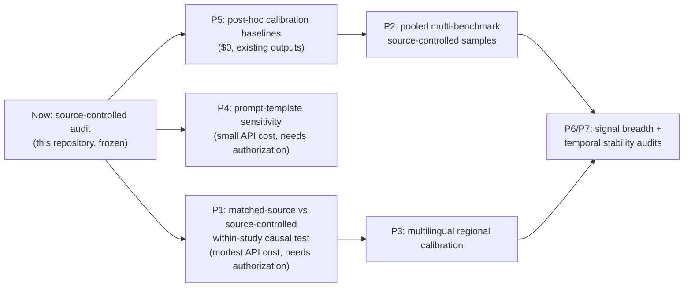

# Research Roadmap

**Companion:** `FUTURE_RESEARCH.md` (design details, costs, risks) · `RESEARCH_GAP_ANALYSIS.md` (what is genuinely open)

## Roadmap (sequenced by dependency and cost)

| # | Work item | Cost class | Dependency | Output |
|---|---|---|---|---|
| 0 | **This repository** (frozen audit, docs, tests) | $0 | — | Public reproducible record |
| 1 | Post-hoc calibration baselines (P5) | $0 | none | Whether regional miscalibration is fixable post hoc |
| 2 | AUPRC addition to metric suite | $0 | none | Closes limitation 10 |
| 3 | Prompt-template sensitivity (P4) | small API | owner approval | Bounded template sensitivity |
| 4 | **Matched-source causal test (P1)** | small API | owner approval | Causal evidence on source confounding |
| 5 | Pooled/multi-benchmark samples (P2) | API for new runs | item provenance work | Larger source-controlled evidence |
| 6 | Multilingual calibration (P3) | API × languages | P4 for template choice | Language vs content effect separation |
| 7 | Signal breadth (P6) + temporal stability (P7) | API per re-run | model-version changes | Longitudinal audit |

## Milestones mapped to publication targets

- **ARR Jan 2027 (ACL 2027):** items 0–2 complete; optionally 3.
- **Mid-2027 (EMNLP/NeurIPS-D&B window):** item 4 (causal test) — the strongest next paper if the effect reappears in the mixed-source arm.
- **2027+:** items 5–7 as the longitudinal program.

## Standing constraints

- No API spend without explicit owner authorization.
- Every new experiment gets a pre-registered analysis plan and the same clustering-aware inferential discipline as this study.
- Null results are reported as nulls with MDE, never as equivalence.
