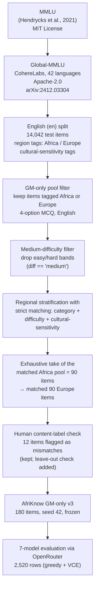

# Dataset Provenance

**Dataset:** AfriKnow GM-only v3 · **Frozen:** yes · **Last verification:** 2026-10-30

## Chain of custody

## Stage-by-stage detail

1. **MMLU (upstream of upstream).** Global-MMLU is a culturally aware re-creation of MMLU in 42 languages; the underlying test questions originate from MMLU (MIT license, Hendrycks et al., 2021).
2. **Global-MMLU (source benchmark).** Produced by CohereLabs with professional translators and community reviewers; tags each item with `region` (including `Africa` and `Europe`), `country`, and `cultural_sensitivity_label` (`CS`/`CA`/`-`). License: **Apache-2.0** (verified on the official dataset card, accessed 2026-10-30). Published alongside the paper "Global MMLU" (Singh et al., 2025; arXiv:2412.03304).
3. **English split.** The audit is English-only by design (a documented limitation): the `en` split of Global-MMLU is used so that translation quality cannot differ between the two regional arms.
4. **GM-only pool.** From the English split, only items carrying an Africa or Europe region tag are eligible. Non-region-tagged items are excluded — this is what makes the slice *source-controlled*: both arms come from the identical benchmark.
5. **Medium-difficulty filter.** Only `diff == "medium"` items are kept. The easy and hard bands are dropped to reduce difficulty skew between regions (all 180 retained items are `medium`; verified 180/180 in the curated file).
6. **Strict regional matching.** Items are matched on (category, difficulty, cultural-sensitivity). The Africa-tagged pool that survives all filters exhausts at exactly 90 items — this is a **hard ceiling** of the design, not a sample-size choice. The Europe side is filled with 90 matched items. `gm_match_level == "strict"` for all 180 items (verified).
7. **Human content-label check.** During curation, each item was checked for agreement between its region tag and its actual content. **12 items (6.7%)** were flagged: US-history content tagged as Africa or Europe (6 + 6). They are **kept** in the main analysis (removing them would shrink an already-ceilinged sample) and a leave-them-out robustness check confirms all conclusions are unchanged.
8. **Freeze.** The 180-item set was frozen (seed 42 for any sampling steps; the Africa arm is exhaustive, so sampling is degenerate on that side). The frozen file is `data/curated/02_gm_only_180_items.json` (SHA-256 `fc07491b188ca2017b15ef93b6c1a9fd5066007362ea5c4e944f60443a52ef52`).
9. **Evaluation.** The 7-model OpenRouter run consumed this frozen file; its outputs (2,520 rows) are the raw analysis data.

## Related provenance artifacts (in this repository)

| Artifact | What it proves |
|---|---|
| `data/metadata/02_sample_design_manifest.json` | The annotation sub-phase design (2026-07-06): a 120-item (60/60) sample drawn for the human content-label check, with category distribution and hashes. It documents the *annotation* stage that fed the curation, not the final 180. |
| `data/metadata/03_openrouter_manifest_v18.json` | The exact run manifest: model IDs, routes, pricing, and metadata for the evaluation. |
| `data/manifests/AFRIKNOW_V18_MANIFEST.yaml` | The master experiment manifest for the run. |
| `reproducibility/hashes/FINAL_FILE_MANIFEST.sha256` | Canonical hash list for the frozen artifacts. |

## Verification of provenance (how you can check)

1. Hash the curated file and compare with the SHA-256 above.
2. Run `python scripts/utilities/generate_gm_only_dataset.py` to regenerate the selection logic from Global-MMLU (requires obtaining the original dataset — see below).
3. Run `python scripts/utilities/validate_pipeline.py` for schema and secret checks.
4. Verify item counts and balance: `python -m tests.test_dataset` or `pytest tests/ -q`.

## Obtaining the original Global-MMLU data

- Official dataset: https://huggingface.co/datasets/CohereLabs/Global-MMLU (Apache-2.0).
- No registration is required at the time of writing. If access conditions change, this repository's released subset (permitted under Apache-2.0) remains the authoritative record of exactly which 180 items were used.

## Redistribution decision record

| Question | Answer | Basis |
|---|---|---|
| May the 180-item subset (question text + options) be published? | **Yes** | Global-MMLU is Apache-2.0 (dataset card, accessed 2026-10-30); Apache-2.0 permits redistribution with license and attribution notices, which this repository provides. |
| May the raw model-output CSV be published? | **Yes** | It contains the project's own recorded model responses and metadata, not upstream content. |
| Are there privacy concerns? | **No** | Items are public benchmark questions; outputs are model-generated text; no personal data is present. |
| Uncertainty | Upstream license could change in future releases; the frozen subset + reconstruction scripts mitigate this. |
